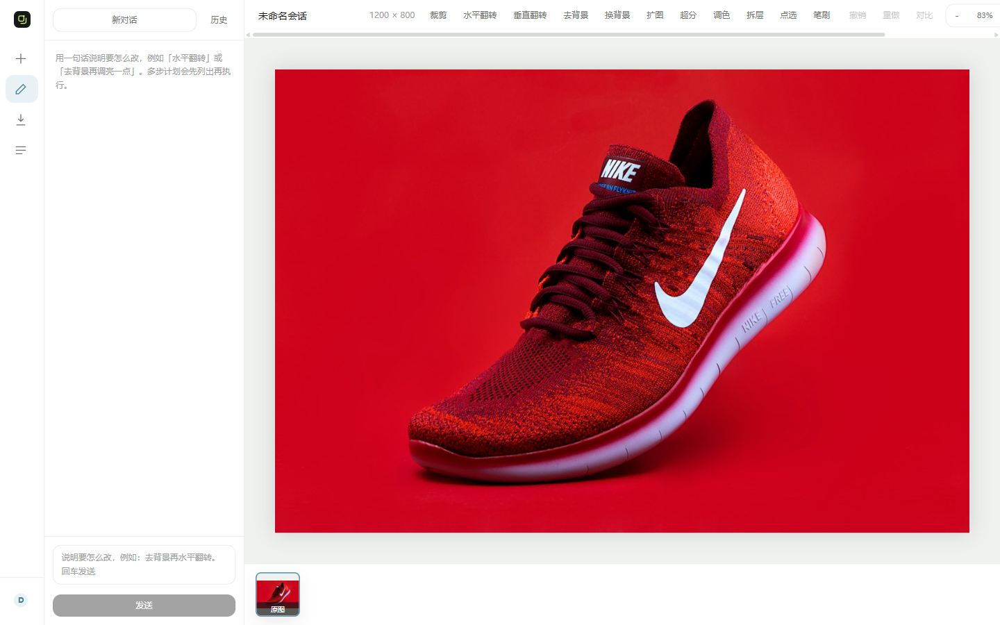
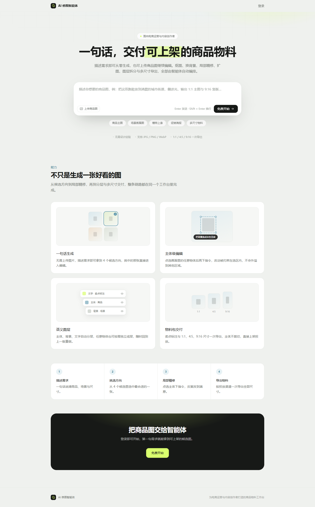
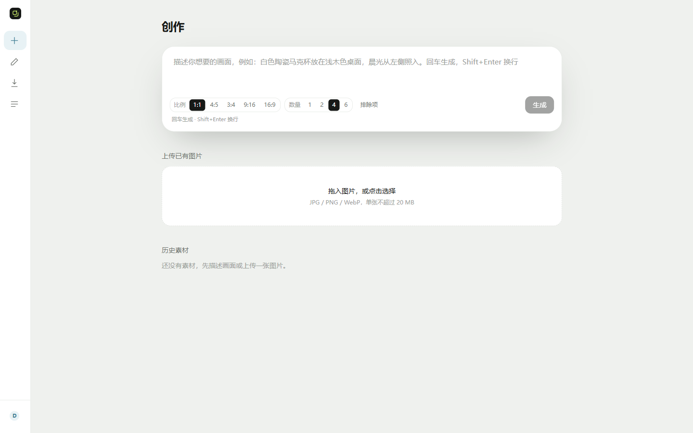
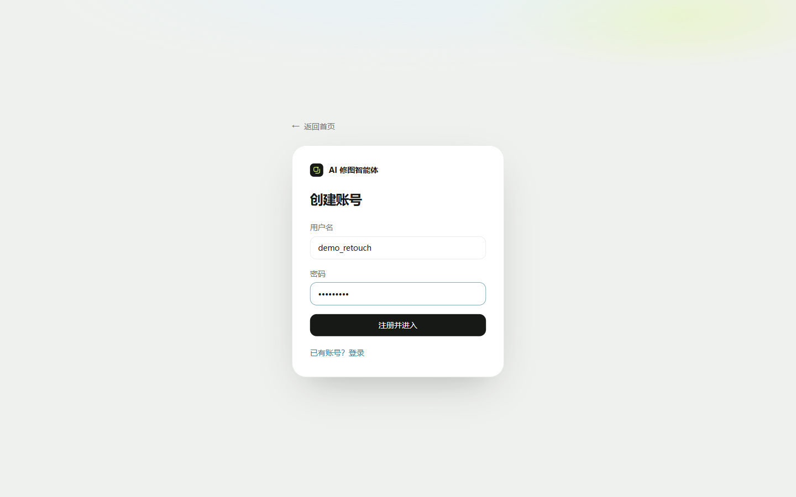
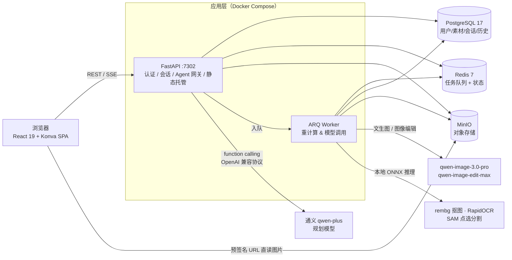
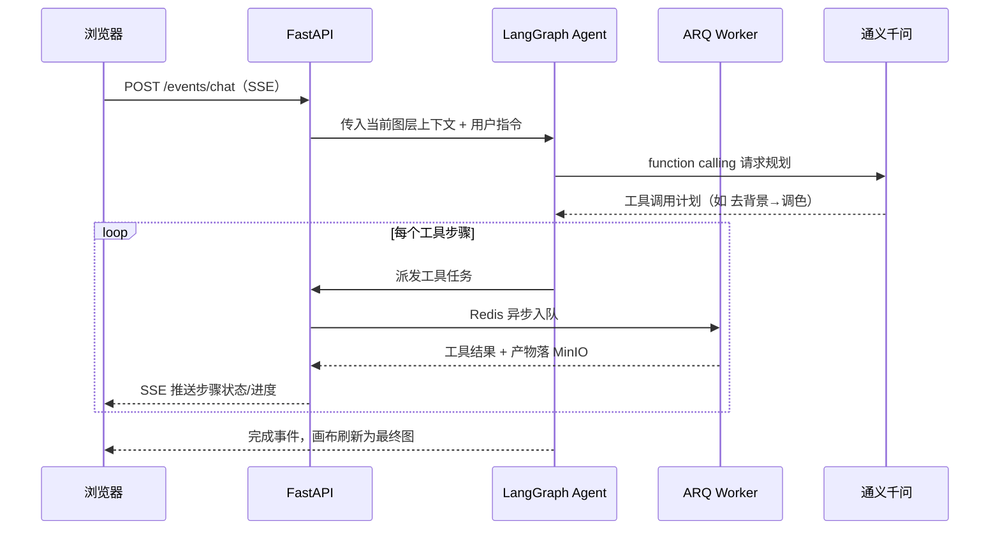

# AI 修图智能体（AI Retouch Agent）

> 一句话驱动的 AI 商品图修图工作台：自然语言下达修图指令，Agent 自动规划步骤并调用 21 种编辑工具，覆盖文生图、抠图换背景、局部精修、语义图层拆分到多尺寸物料导出的完整链路。


**🌐 在线演示**：http://123.56.226.51:7302 （演示账号：`demo_retouch` / `Demo@2026`，数据公开，请勿存放隐私素材）

**📘 API 文档**：服务启动后访问 `/api/docs`（Swagger UI）



## 一、产品介绍

面向电商运营与内容创作者的 **AI Agent 全栈项目**。两种使用方式：

- **从零生成**：输入一句话需求（如"一双跑鞋放在清晨的城市街道，侧逆光，输出 1:1 主图和 9:16 竖版"），文生图模型一次给出 4 张候选，选中即进入编辑；
- **上传精修**：上传已有商品图，用自然语言指挥 Agent 完成抠图、换背景、调色、扩图、超分等操作，也可手动使用工具栏。



## 二、核心功能

| 模块 | 能力 |
|---|---|
| 🗣️ 自然语言修图 | 基于 LangGraph 的 Agent：理解指令 → function calling 规划多步计划 → 依次调用工具 → 观察结果直至完成，全过程 SSE 实时流式反馈 |
| 🎨 文生图 | 通义 qwen-image 异步任务轮询，四宫格候选，支持比例（1:1/4:5/9:16 等）、数量、排除项 |
| ✂️ 一键抠图/换背景 | rembg（u2net ONNX）本地推理，换背景走 AI 图像编辑模型 |
| 🖱️ 智能区域选择 | SAM（Segment Anything）点选分割：首次计算 embedding，后续点击仅跑 decoder，毫秒级响应；另支持笔刷涂抹选区，局部编辑被约束在选区内 |
| 📝 语义图层拆分 | RapidOCR 识别文字并自动拆出文字层（可改文案），主体/背景/文字分层管理，任意物体可独立成层 |
| 🛠️ 21 种编辑工具 | 11 参调色（亮度/对比度/饱和度/色温等）、裁剪/翻转/旋转/缩放、AI 扩图、超分辨率等；**UI 与 Agent 共享同一套工具注册表** |
| 🖼️ 专业画布编辑器 | react-konva 实现：缩放平移、撤销重做、前后对比滑杆、历史版本回溯 |
| 📦 物料包导出 | 卖点标注 + 1:1 / 4:5 / 9:16 多尺寸一次导出；支持批量任务 |
| 🔐 完整账号体系 | 注册登录、bcrypt 密码哈希、JWT HttpOnly Cookie 会话 |




## 三、系统架构



**一次自然语言修图的链路**：



## 四、技术栈

**后端**：Python 3.13 · FastAPI · SQLAlchemy 2（async）· Alembic · Pydantic Settings · ARQ（异步任务队列）· boto3（S3 协议）· bcrypt / PyJWT · httpx

**AI 层**：LangChain · LangGraph（含 PostgreSQL checkpointer 持久化）· langchain-openai（OpenAI 兼容协议接入）· 阿里云百炼 DashScope（qwen-plus 规划 / qwen-image 系列生图与编辑）· rembg · ONNX Runtime · OpenCV · RapidOCR · SAM

**前端**：React 19 · TypeScript · Vite · Tailwind CSS v4 · react-konva（Canvas 画布引擎）· Zustand · TanStack Query · React Router v7

**基础设施**：Docker Compose（多阶段构建单镜像）· PostgreSQL 17 · Redis 7 · MinIO · Nginx（可选 HTTPS 反代）

## 五、工程亮点

1. **Agent 与 UI 共用工具注册表**：所有修图能力注册为统一工具（统一入参/产物/元数据），Agent function calling 与手动按钮复用同一实现，杜绝两套逻辑漂移。
2. **长耗时任务全异步化**：抠图、生图等 CPU/IO 密集任务由 ARQ Worker 经 Redis 队列消费，API 不阻塞；进度通过 SSE 实时推送（事件流独立于 `/api`，便于反代单独关闭缓冲）。
3. **多模型 Provider 抽象**：图像能力定义统一接口，`mock`（本地占位图，零成本开发）/ `dashscope`（真实模型）通过环境变量切换。
4. **对象存储安全接入**：图片走 MinIO S3 协议，浏览器使用预签名 URL 直读；内/外网 Endpoint 分离（容器内走内网域名，浏览器走公网）。
5. **生产级容器化**：多阶段 Dockerfile（node 构建前端 → python-slim 合并后端，单镜像同源托管）；中间件健康检查、`restart: unless-stopped`、命名卷持久化 CV 模型。
6. **真实部署踩坑修复**：HTTP 部署下 Cookie Secure 导致无法登录的问题（增加 `COOKIE_SECURE` 显式开关，HTTPS 默认安全）；前端路由硬刷新 404（StaticFiles 增加 SPA fallback）。
7. **国内环境适配**：Dockerfile 的 apt/pip/npm 全部切换为国内镜像源，解决 ghcr.io 拉取失败与 Debian 源超时问题。
8. **无成本可运行**：默认 `mock` 模式不需要任何 API Key 即可完整体验手动修图全流程。

## 六、项目结构

```
.
├── backend/                # FastAPI 后端
│   ├── app/
│   │   ├── agent/          # LangGraph 图、规划模型接入
│   │   ├── routers/        # 认证/素材/会话/事件流(SSE)/批量等路由
│   │   ├── services/       # 业务编排（Agent 服务、生成、导出…）
│   │   ├── tools/          # 21 种修图工具（Agent/UI 共享注册表）
│   │   ├── edits/          # 像素编辑、OCR、蒙版、渲染管线
│   │   ├── providers/      # 图像模型 provider 抽象（mock/dashscope）
│   │   ├── tasks/          # ARQ 异步任务
│   │   ├── models/         # SQLAlchemy 模型
│   │   └── worker.py       # Worker 入口
│   └── migrations/         # Alembic 数据库迁移
├── frontend/               # React 19 SPA（Konva 画布编辑器）
│   └── src/
├── deploy/                 # 生产部署：Nginx 配置 + 环境变量模板
├── docker-compose.yml      # dev（中间件）/ deploy（全量生产）双 profile
└── Dockerfile              # 多阶段构建
```

## 七、快速开始

### 方式 A：一键生产形态（推荐，需要 Docker）

```bash
cp deploy/env.production.example .env   # 填入 DASHSCOPE_API_KEY；不填则保持 mock 零成本模式
docker compose --profile deploy up -d --build
docker compose --profile deploy exec app alembic upgrade head
# 打开 http://localhost:7302
```

### 方式 B：本地开发模式

```bash
# 1. 启动中间件（PostgreSQL:7311 / Redis:7312 / MinIO:7313）
cp .env.example .env
docker compose up -d

# 2. 后端（需要 uv，Python 3.13）
cd backend
uv sync --all-extras
uv run alembic upgrade head
uv run uvicorn app.main:app --reload --port 7302

# 3. 前端
cd frontend
npm install
npm run dev      # http://localhost:7301 （已配 /api、/events 代理到 7302）
```

### 关键环境变量（见 `.env.example`）

| 变量 | 说明 |
|---|---|
| `IMAGE_PROVIDER` | `mock`（默认，零成本占位图）/ `dashscope`（真实模型） |
| `DASHSCOPE_API_KEY` | 阿里云百炼 Key，切真实模型时必填 |
| `JWT_SECRET` | 生产环境必须替换为随机值（`openssl rand -hex 32`） |
| `COOKIE_SECURE` | HTTP 访问填 `false`；启用 HTTPS 后改为 `true` |
| `S3_PUBLIC_ENDPOINT` | 浏览器访问图片的公网地址（生产部署改为 `http://公网IP:7313`） |

## 八、生产部署记录

已在阿里云轻量服务器（Ubuntu 22.04，Docker Compose）完成真实公网部署：

- 5 容器生产栈（app + worker + PostgreSQL + Redis + MinIO），`--profile deploy` 一键拉起；
- Alembic 迁移管理库表；Nginx 反代模板见 [deploy/nginx/ai-retouch.conf](deploy/nginx/ai-retouch.conf)，含 SSE 关闭缓冲配置；
- 云安全组放行 7302（应用）与 7313（图片）端口。

## 九、说明

本项目基于公开全栈教程实战完成，在教程基础上独立完成了本地环境搭建、生产级 Docker 部署、国内网络适配，以及 HTTP Cookie 安全策略、SPA 路由 fallback 等问题的排查与修复，用于个人全栈与 AI Agent 工程化学习。
